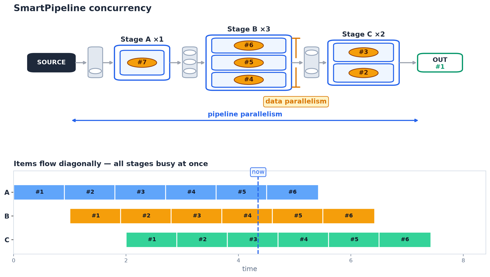

.. _concurrency:

.. _concurrency-section:

Concurrency and parallelism
===========================

This page explains how ``concurrency`` and ``executor`` work, how to choose
between threads and processes, and how to write stages that run safely in both
modes.

   Top: a pipeline snapshot. Items (orange) sit in stage workers while others
   wait in bounded queues. ``Stage B ×3`` runs three workers on items
   ``#4``-``#6`` (data parallelism), while all stages hold different items at
   once (pipeline parallelism). Bottom: the same execution over time; items
   flow diagonally, so the vertical ``now`` slice cuts one item per stage.

Execution modes
---------------

Each stage selects its execution mode via the ``concurrency`` and ``executor``
arguments of :meth:`.Pipeline.append`:

* ``concurrency=0`` (default): **inline execution**. No worker threads or
  processes are spawned for this stage. Consecutive inline stages execute as a
  direct chain of :meth:`.Stage.process` calls with no queues in between; if
  every stage in the pipeline is inline, the entire pipeline runs on the
  caller's thread.
* ``concurrency>=1, executor="threads"`` (default executor): the stage runs on
  ``concurrency`` worker threads. Ideal for I/O-bound work (HTTP calls, file or
  database queries) and native libraries that release the GIL.
* ``concurrency>=1, executor="processes"``: the stage runs on ``concurrency``
  worker processes. Ideal for pure-Python CPU-bound work that would otherwise
  be serialized by Python's `GIL <https://en.wikipedia.org/wiki/Global_interpreter_lock>`_.

A :class:`.BatchStage` always runs on a worker so it can accumulate items up to
its ``size`` or ``timeout``; if configured with ``concurrency < 1``, it is
automatically promoted to ``concurrency=1, executor="threads"``.

Queues between concurrent stages are bounded by ``max_queues_size`` on
:class:`.Pipeline` (1000 items by default). When a slow stage fills its input
queue, upstream stages and the source block until space frees up, providing
automatic backpressure and bounding memory usage. Pass ``0`` to remove the bound
(no backpressure: a fast source grows the queues until memory runs out).

Choosing threads or processes
-----------------------------

Worker processes are not automatically faster than threads: every item crossing
a process boundary is pickled through an inter-process queue, which adds roughly
0.2-0.5 ms per item regardless of what the stage does. Choose the executor
based on the work per item:

.. list-table::
   :header-rows: 1

   * - Work per item
     - Recommended setting
   * - Waiting on I/O (HTTP, disk, database)
     - ``executor="threads"``
   * - C extensions that release the GIL (``numpy``, ``scikit-learn``, ``zlib``)
     - ``executor="threads"``
   * - Pure-Python CPU work below ~0.2 ms per item
     - ``concurrency=0`` (inline) or ``executor="threads"``
   * - Pure-Python CPU work of ~1 ms or more per item, or few large items
     - ``executor="processes"``

Note that a :class:`.BatchStage` batches items *inside* its worker to amortize
bulk calls (such as model inference or batch HTTP endpoints), but items still
travel through queues one by one. If inter-process queue transport is the
bottleneck, pack multiple records into a single chunk :class:`.Item` or merge
adjacent CPU steps into one stage.

You can measure the break-even on your machine with ``examples/benchmark.py``,
and compare ``examples/log_lake_etl.py`` (many small items) with
``examples/genome_kmers.py`` (fewer, CPU-heavy items).

Reading stage timings
---------------------

Every processed item records the wall-clock time spent in each stage:

.. code-block:: python

    for item in pipeline.run():
        for stage_name in item.timed_stages:
            print(stage_name, f"{item.get_timing(stage_name) * 1000:.2f} ms")

Keep in mind when interpreting timings:

* They measure wall-clock time inside ``process`` / ``process_batch`` (including
  I/O wait, retries, and GIL contention on threads), not pure CPU time, and they
  exclude time spent waiting in queues.
* For a :class:`.BatchStage`, each item in a batch receives the average
  per-item duration of that batch (``batch_elapsed / len(batch)``).
* Summed across concurrent workers, stage timings can exceed total elapsed wall
  time. Use them to spot bottleneck stages rather than to measure end-to-end
  latency.

How stages on processes work
----------------------------

Unlike threads, OS processes do not share memory. SmartPipeline starts worker
processes using the ``spawn`` method and sends a copy of the stage to each
worker with `pickle <https://docs.python.org/3/library/pickle.html>`_. Items
are likewise pickled whenever they cross a queue into or out of a process
stage.

This has three practical consequences:

1. **Picklability**: the stage instance (and everything stored on ``self`` in
   ``__init__``) as well as every :class:`.Item` must be picklable.
2. **Independent copies**: each worker process owns its own copy of the stage
   and of the :class:`.ErrorManager`. Mutating ``self`` in one process is
   invisible to other processes and to the main process.
3. **Per-process resources**: unpicklable objects (open files, sockets, database
   or HTTP clients) must be created inside each worker after spawning, not in
   ``__init__``.

By contrast, a threaded stage exists as a single instance shared by all of its
worker threads, so mutating attributes on ``self`` from multiple threads
requires thread-safe synchronization.

Initializing resources with ``on_start`` and ``on_end``
-------------------------------------------------------

Use :meth:`.Stage.on_start` and :meth:`.Stage.on_end` to manage resources
cleanly across inline, threaded, and process stages:

* :meth:`.Stage.on_start` runs when the pipeline starts (in :meth:`.Pipeline.run`
  or :meth:`.Pipeline.process_async`, never in :meth:`.Pipeline.build`). On
  process stages, it runs once inside each worker process on that worker's copy
  before any item is processed. On inline or threaded stages, it runs once on
  the stage instance.
* :meth:`.Stage.on_end` runs when the worker shuts down (including on pipeline
  errors) for every stage whose ``on_start`` completed. Use it to flush buffers
  or close connections opened in ``on_start``.

The same hooks exist on :class:`.ErrorManager` (:meth:`.ErrorManager.on_start`
and :meth:`.ErrorManager.on_end`).

Store plain, picklable configuration in ``__init__`` and open clients, files, or
large models lazily in ``on_start``:

.. code-block:: python

    from elasticsearch import Elasticsearch
    from smartpipeline import Stage

    class Indexer(Stage):
        def __init__(self, es_host: str, es_index: str):
            self.es_host = es_host
            self.es_index = es_index
            self.es_client = None

        def on_start(self):
            # Elasticsearch clients are not picklable, ensuring one per process
            self.es_client = Elasticsearch(self.es_host)

        def on_end(self):
            if self.es_client is not None:
                self.es_client.close()

        def process(self, item):
            self.es_client.index(index=self.es_index, body=item.data)
            return item

.. note::
   Because :class:`.ErrorManager` is also copied into each worker process,
   custom counters updated inside :meth:`.ErrorManager.handle` only count
   errors seen by that worker. For pipeline-wide totals, read
   :attr:`.Pipeline.soft_errors_count` and
   :attr:`.Pipeline.critical_errors_count`, or inspect the yielded items.

Managing state across workers
-----------------------------

Per-worker state
^^^^^^^^^^^^^^^^

Because each process worker has its own stage copy, standard instance attributes
act as isolated per-worker state, useful for local caches, buffers, or per-worker
counters:

.. code-block:: python

    class CountingStage(Stage):
        def __init__(self):
            self._count = 0

        def process(self, item):
            # counts only the items handled by this worker process
            self._count += 1
            item.metadata["seen_by_worker"] = self._count
            return item

Avoiding or sharing global state
^^^^^^^^^^^^^^^^^^^^^^^^^^^^^^^^

Whenever possible, prefer **shared-nothing** designs over cross-process mutable
state:

* **Carry state in the item**: store intermediate values in ``item.data`` or
  ``item.metadata``.
* **Aggregate downstream**: compute partial results in concurrent workers and
  merge them in a downstream stage with ``concurrency=0``, which sees every
  item sequentially in a single instance.
* **Use an external store**: write shared state that must outlive the run (such
  as deduplication sets or checkpoints) to SQLite, Redis, or a database.

If workers genuinely need small, low-frequency shared state in memory, create a
`multiprocessing.Manager <https://docs.python.org/3/library/multiprocessing.html#managers>`_
in the main process and pass its picklable proxies (``dict``, ``list``,
``Value``, ``Lock``) into the stage's ``__init__`` (never create the manager
inside ``on_start``, which would spawn separate managers per worker):

.. code-block:: python

    from multiprocessing import Manager
    from smartpipeline import Pipeline, Stage

    manager = Manager()
    shared_stats = manager.dict({"processed": 0})
    shared_lock = manager.Lock()

    class SharedCountingStage(Stage):
        def __init__(self, stats, lock):
            self._stats = stats
            self._lock = lock

        def process(self, item):
            with self._lock:
                self._stats["processed"] += 1
            return item

    pipeline = (
        Pipeline()
        .append(
            "counter",
            SharedCountingStage(shared_stats, shared_lock),
            concurrency=4,
            executor="processes",
        )
        .build()
    )

Logging in stages on processes
------------------------------

Worker processes spawned with ``spawn`` do not inherit the parent process's
logging configuration. SmartPipeline automatically forwards log records emitted
through :attr:`.Stage.logger` back to the main process, so your handlers receive
them as usual, but logger levels set only in the parent process are not copied.

Set the desired level on ``self.logger`` inside :meth:`.Stage.on_start` so every
worker configures its logger before processing items:

.. code-block:: python

    import logging
    from smartpipeline import Stage

    class LoggingStage(Stage):
        def on_start(self):
            self.logger.setLevel(logging.INFO)

        def process(self, item):
            self.logger.info("processing %s", item)
            return item
