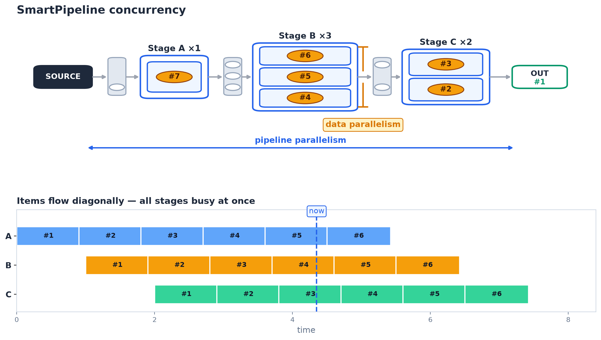

.. _concurrency:

.. _concurrency-section:

Concurrency and parallelism
===========================

This page explains how ``concurrency`` and ``executor`` work,
and what a stage must do to run correctly on threads and on processes.

   Top: a pipeline snapshot. Items (orange) sit in stage workers while others
   wait in queues. ``Stage B ×3`` runs three workers on items ``#4``–``#6``:
   that is data parallelism. All stages holding different items at once:
   that is pipeline parallelism. Bottom: the same execution over time, items
   flow diagonally, so the vertical ``now`` slice cuts one item per stage.

``×N`` is the ``concurrency`` argument of :meth:`.Pipeline.append`
(threads by default, processes with ``executor="processes"``).
``concurrency=0`` means inline execution: no workers, no queues, no overlap.

Concurrency vs. parallelism
---------------------------

There are three ways to run a stage, selected per stage
with the ``concurrency`` and ``executor`` arguments of :meth:`.Pipeline.append`:

* ``concurrency=0`` (default): *inline* execution.
  No threads or processes are involved.
  Each item flows through a simple chain of :meth:`.Stage.process` calls.
* ``concurrency>=1, executor="threads"`` (default): the stage runs on ``concurrency`` threads.
  Good for I/O-bound work (HTTP calls, file reads, database queries),
  where threads spend most of their time waiting.
* ``concurrency>=1, executor="processes"``: the stage runs on ``concurrency`` processes.
  Good for CPU-bound work (text processing, model inference),
  because threads cannot run Python code in parallel
  due to the `GIL <https://en.wikipedia.org/wiki/Global_interpreter_lock>`_.

With any concurrent stage, items travel through queues between stages
and may be pickled.
A ``BatchStage`` with ``concurrency<1`` is automatically promoted
to ``concurrency=1`` on threads.

How stages on processes work
----------------------------

OS processes do not share memory, unlike threads.
SmartPipeline starts its worker processes with the ``spawn`` method
and copies each process-based stage into every worker process with
`pickle <https://docs.python.org/3/library/pickle.html>`_.
Communication between processes also goes through queues,
which means items are serialized on every hand-off.

Consequences:

* A stage on processes, and everything stored on it, must be picklable.
* Each worker process owns an independent *copy* of the stage.
  Mutating an attribute in one worker is invisible to the others.
* Objects that cannot be pickled (open files, sockets, most clients)
  or should not be shared (one connection per process)
  cannot be created in ``__init__``; they must be created per process
  (see below).

By contrast, a threaded stage exists only once:
all of its worker threads share the same object,
so shared attributes need thread-safe access.

Making stages process-safe with ``on_start`` and ``on_end``
------------------------------------------------------------

:meth:`.Stage.on_start` initializes a stage *after* it has been copied
into its worker process.
It is called once per process, on that process's copy,
before the copy processes its first item.
Without multiprocessing it is simply called once after ``__init__``.
:meth:`.Stage.on_end` is the mirror hook: it runs when the worker terminates,
including when the pipeline terminates because of a failure, and is the right
place to close files or connections opened in ``on_start``.
A stage whose construction or ``on_start`` fails before the pipeline starts may
not reach ``on_end``.
The same pair of hooks exists on :class:`.ErrorManager`
as :meth:`.ErrorManager.on_start` and :meth:`.ErrorManager.on_end`,
because the error manager is copied into worker processes together with the stage.

Take the Elasticsearch example from the :doc:`usage` guide.
``Elasticsearch(...)`` clients are not picklable
(try ``pickle.dumps(Elasticsearch('localhost'))`` yourself),
and even if they were, sharing one connection object across processes
would be unreliable.
The fix is small: keep only plain configuration in ``__init__``
and create the client in ``on_start``.

.. code-block:: python

    class ESErrorLogger(ErrorManager):

        def __init__(self, es_host: str, es_index: str):
            self.es_host = es_host
            self.es_index = es_index
            self.es_client = None

        def on_start(self):
            self.es_client = Elasticsearch(self.es_host)

    class Indexer(Stage):

        def __init__(self, es_host: str, es_index: str):
            self.es_host = es_host
            self.es_index = es_index
            self.es_client = None

        def on_start(self):
            self.es_client = Elasticsearch(self.es_host)

This pattern also avoids copying large data into every process:
load models, open files, or connect clients lazily in ``on_start``.
As a rule, whenever an attribute needs special per-process construction,
create it in ``on_start`` (leaving a ``None`` placeholder in ``__init__``)
so the stage works in all three modes: inline, threaded, and on processes.

Per-worker local state
----------------------

Because each process worker owns a copy of the stage,
plain instance attributes are a natural *per-worker* state:
each process accumulates its own values without interfering with the others.

.. code-block:: python

    class CountingStage(Stage):
        def __init__(self):
            self._count = 0

        def process(self, item):
            # each worker counts only the items it has seen itself
            self._count += 1
            item.metadata["seen_by_this_worker"] = self._count
            return item

This is ideal for caches, buffers, per-process connections, or loaded models:
initialize the attribute in ``__init__`` (picklable value)
or in ``on_start`` (non-picklable resource),
mutate it freely in ``process``, and optionally flush or close it in ``on_end``.
Keep in mind that no worker sees the full stream,
so per-worker counters never add up to a global total by themselves.

Sharing state between workers
-----------------------------

Sometimes workers genuinely need shared state, e.g. a global counter
or a dictionary visible to every process.
Since processes do not share memory, the standard tool is a
`multiprocessing manager <https://docs.python.org/3/library/multiprocessing.html#managers>`_,
which exposes proxy objects (``dict``, ``list``, ``Value``, ``Lock``, ...)
whose operations are forwarded to a server process.

Create the manager and its proxies in the main process and pass the proxies
into the stage constructor: proxies are picklable, so the stage stays picklable.
Do not create the manager inside ``on_start``: that would give each worker
its own independent manager instead of one shared object.

.. code-block:: python

    from multiprocessing import Manager

    manager = Manager()
    shared_stats = manager.dict({"processed": 0})
    shared_lock = manager.Lock()

    class SharedCountingStage(Stage):
        def __init__(self, stats, lock):
            self._stats = stats
            self._lock = lock

        def process(self, item):
            # proxy access is a remote call: correct, but much slower than local memory
            with self._lock:
                self._stats["processed"] += 1
            return item

    pipeline = (
        Pipeline()
        .append("counter", SharedCountingStage(shared_stats, shared_lock),
                concurrency=4, executor="processes")
        .build()
    )

Shared proxies come with real costs: every read or write is inter-process
communication, all mutations need explicit locking to avoid races,
failures of the manager process break every worker,
and the code becomes harder to test.
For these reasons, prefer one of the alternatives below whenever possible.

Prefer shared-nothing designs
-----------------------------

In most pipelines shared mutable state is a sign that the work can be reorganized:

* *Aggregate downstream.* Keep per-worker partial results as local state
  and combine them in a later, non-concurrent stage
  (``concurrency=0`` sees every item in order).
* *Carry state in the items.* Put counters, accumulations, or flags
  in ``item.data`` or ``item.metadata`` instead of on the stage.
* *Use an external store.* For state that must survive or be visible outside
  the pipeline (progress, deduplication sets, caches), write to a database,
  a file, or a service such as Redis, rather than to process memory.

Reach for a ``Manager`` only for small, low-frequency coordination
(e.g. a global progress counter), not for per-item hot paths.

Logging in stages on processes
------------------------------

Worker processes do not inherit the parent logging configuration
(when ``spawn`` is used, there is no inherited memory at all).
SmartPipeline forwards log records emitted through :attr:`.Stage.logger`
back to the main process, but logger *configuration*
(levels, handlers, formatters) must be applied per process.

Configure :attr:`.Stage.logger` inside ``on_start`` so every worker copy
sets up its own logging consistently:

.. code-block:: python

    class LoggingStage(Stage):
        def on_start(self):
            self.logger.setLevel(logging.INFO)

        def process(self, item):
            self.logger.info("processing %s", item)
            return item
